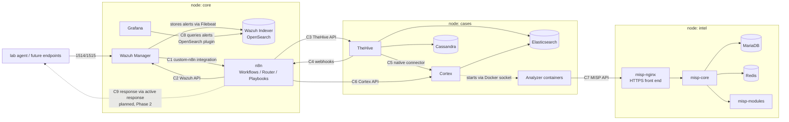

# ASOX SOC Platform — Project Specification

> **Version:** 2.1 (final plan) — Phase 1 (baseline platform) and the team development model. Changes since 1.0 are recorded in the decisions log (section 15). This is the *document* version; repo milestones use git tags (e.g. `v1.0-baseline`).
>
> **Audience:** This is the source of truth for the Claude Code session that builds Phase 1, and for the team that develops the components afterwards.
> - Claude Code reads the whole document before creating files, follows the build steps in section 10 in order, and updates section 17 (Status) as work progresses.
> - When blocked by an item marked **[ASSUMPTION]** or **[OPEN]**, Claude Code picks the simplest option and logs it in `docs/decisions.md`.
> - Companion documents: `CHECKLIST.md` (tools and prerequisites) and `CLAUDE.md` (a short pointer that Claude Code reads automatically at the start of every session).

---

## 1. Project overview

A containerized SOC built from open-source tools, with an agentic AI assistant (ASOX) planned on top.

| Stage | Scope | Who |
|---|---|---|
| **Phase 1 — Baseline platform** | Deploy the five main components, verify every service is healthy and every integration can connect and authenticate. Deliver a GitHub repo ready for parallel team work. | Claude Code (this document); the integrator pushes to GitHub |
| **Component development** | Each teammate develops one of the five components (Wazuh, n8n, TheHive, Grafana, Cortex + MISP) in parallel through GitHub, starting from the baseline. | Team (section 11) |
| Phase 2 — [OPEN] | Likely network visibility (Snort on its own machine), real endpoints / pfSense, response actions | Later |
| Phase 3 — [OPEN] | Likely ASOX agentic AI (orchestrator, memory, sub-agents) and the Slack bot | Later |

Phases 2 and 3 are described in section 13 only so Phase 1 decisions don't block them.

---

## 2. Phase 1 objectives

1. Run the five main components with Docker on a **Windows + WSL2 host with 32 GB RAM** (the baseline build machine), while keeping a **low-memory profile** that fits teammates' machines with 8 GB (section 8).
2. Group them into **three self-contained deployment nodes** (`core`, `cases`, `intel`) that run on **one host or across several hosts** with the same files. Only configuration changes between the two.
3. Verify that **every service is healthy** and that **every integration between components connects and authenticates** (the integration contracts in section 5).
4. Structure the repo so **each of the five components is owned and developed independently** by a teammate through GitHub, without stepping on the others.
5. Make the platform replicable on any machine through **GitHub + `soc.sh init`**, with **backup/restore scripts** to protect and move data (section 9).

**Phase 1 deliberately does NOT build:** detection rules beyond a test rule, real playbooks, case templates, production dashboards, intel feeds or custom analyzers. Those are the component owners' work (section 11). Also out of scope: the Wazuh dashboard, Snort, ASOX, the Slack bot, real endpoints, pfSense and response actions.

**Phase 1 is done when** all build steps in section 10 pass, in particular:
- `healthcheck.sh` is all green and `contracts-check.sh` passes C1–C8 in `full` mode in `standard`, and each dev mode that must fit on `low` passes its checks there (step 1.7, D39);
- the distribution simulation and the backup round trip pass (step 1.8);
- the fresh-clone test passes, and the baseline is tagged `v1.0-baseline` and pushed to GitHub by the integrator (step 1.9).

---

## 3. Components and nodes

The project has two views of the same services:

- **Components** are how work is divided: 5 components, each with one owner.
- **Nodes** are how it is deployed: 3 nodes, each a unit that runs on one machine.

| Component | Services | Node | Owner |
|---|---|---|---|
| **Wazuh** | wazuh-manager, wazuh-indexer | `core` | Daniel (@dmelgar1110) |
| **n8n (SOAR)** | n8n | `core` | Inigo (@poinsot), also the integrator |
| **Grafana** | grafana | `core` | Jesus (@JC-535) |
| **TheHive** | thehive, cassandra, elasticsearch (shared storage) | `cases` | Park (@Jinhyuk-P) |
| **Cortex + MISP** | cortex, analyzer containers (in `cases`); misp-core, misp-nginx, misp-modules, mariadb, redis (in `intel`) | `cases` + `intel` | Diego (@DiegoGuerraA00835430) |
| *(test only)* lab | one Wazuh agent container | `lab` | Wazuh owner |

### 3.1 Nodes

| Node | Why these services are grouped | Exposed host ports |
|---|---|---|
| `core` | Grafana only reads the Wazuh indexer and n8n talks to the Wazuh API constantly. The indexer stays internal and is never exposed on the LAN. | 1514/tcp, 1515/tcp (agents), 514/udp (syslog), 55000 (Wazuh API), 5678 (n8n), 3000 (Grafana) |
| `cases` | TheHive and Cortex share one Elasticsearch internally, which is StrangeBee's reference layout. | 9000 (TheHive), 9001 (Cortex) |
| `intel` | MISP is independent (Cortex only calls its API), so it's the easiest node to move. | 9443 (MISP) |
| `lab` | Optional test agent that generates events without real endpoints | none |

**Port binding:** in single-host mode, published ports bind to `127.0.0.1` only, so services aren't reachable from the LAN. In distributed mode they bind to `0.0.0.0`. `render-env.sh` sets this through `BIND_ADDR` (D16).

**The Wazuh dashboard is not deployed.** Grafana is the visual layer for alerts, and `scripts/wazuh-query.sh` queries the indexer from the command line.

### 3.2 Integration map



---

## 4. Deployment modes: single-host and multi-host

**Every service reaches every other service through a URL defined in configuration, never through a hardcoded container name or IP.** This applies inside a node too, so any service can later be moved out of its group with configuration only.

- Service URLs are environment variables: `WAZUH_API_URL`, `WAZUH_INDEXER_URL`, `N8N_WEBHOOK_URL`, `THEHIVE_URL`, `CORTEX_URL`, `MISP_URL`, plus `WAZUH_MANAGER_ADDR` for agent enrollment (the `wazuh-manager` alias in single-host mode, `CORE_HOST` in distributed mode).
- Values come from one file, `topology.env`, rendered into each node's `.env` by `scripts/render-env.sh`.
- **Intra-node** URLs default to the node's private network aliases (e.g. `http://elasticsearch:9200`).
- **The Wazuh indexer is addressed as `wazuh.indexer`**, not by its service name: `WAZUH_INDEXER_URL=https://wazuh.indexer:9200` in every mode. `wazuh.indexer` is a network alias of the `wazuh-indexer` service and the DNS name in its TLS certificate; the official Wazuh certificate tool only accepts dotted names, so the certificate can't be issued for `wazuh-indexer`. The indexer is internal to `core`, so the URL never changes with `DEPLOY_MODE` (D32).
- **Single-host mode:** all nodes also join a shared external Docker network `soc-net`, and cross-node URLs point to container aliases (e.g. `http://thehive:9000`). The attachment lives in a small per-node override file, `nodes/<node>/soc-net.yml`, which `soc.sh` adds only when `DEPLOY_MODE=single`.
- **Multi-host (distributed) mode:** cross-node URLs point to the host IP of the machine running that node (e.g. `http://192.168.1.11:9000`) through the published ports in 3.1.

```env
# topology.env (copied from topology.env.example; never committed)
DEPLOY_MODE=single            # single | distributed
MEM_PROFILE=standard          # standard | low (section 8)
SOC_INSTANCE=asox             # prefix for compose project names (section 12)

# Host of each node (only used in distributed mode)
CORE_HOST=192.168.1.10
CASES_HOST=192.168.1.11
INTEL_HOST=192.168.1.12
```

From these, `render-env.sh` derives every URL, `WAZUH_MANAGER_ADDR`, `BIND_ADDR`, heap sizes and `CORTEX_JOBS_HOST_DIR`, and writes them into `nodes/<node>/.env`.

**Values copied between nodes (`__from:<node>__`).** A few secrets are created on one node and used by another. In the consuming node's `.env.example` their value is the marker `__from:<source node>__`, and `render-env.sh` copies the same key from `nodes/<source node>/.env`:

| Key | From → to | Created by | Used for |
|---|---|---|---|
| `MISP_CORTEX_API_KEY` | intel → cases | `bootstrap.sh intel` | Cortex's MISP analyzer (C7) |
| `THEHIVE_N8N_API_KEY`, `CORTEX_N8N_API_KEY` | cases → core | `bootstrap.sh cases` | n8n's TheHive and Cortex credentials (C3, C6) |
| `N8N_WEBHOOK_TOKEN` | core → cases | `render-env.sh` (a `__secret__` of core) | TheHive's webhook to n8n (C4) |

- **Single-host mode:** automatic. `soc.sh init` bootstraps `intel → cases → core → lab`, re-rendering every `.env` before each bootstrap, so a value created by an earlier bootstrap reaches the next node in the same `init` (A62). While the source value doesn't exist yet, the key stays empty without a warning. After a source node is reset or its keys are renewed, run `render-env.sh` and bootstrap the consumers again (e.g. `bootstrap.sh cases` after `soc.sh reset intel`, `bootstrap.sh core` after `soc.sh reset cases`, `bootstrap.sh cases` after `N8N_WEBHOOK_TOKEN` changes).
- **Distributed mode:** the source `.env` is on another machine, so the value is **copied by hand**. Bootstrap the source node first; on its machine, read the key from `nodes/<source>/.env`; on the consuming machine, paste it as `KEY=value` into `nodes/<consumer>/.env`, then run `render-env.sh` (it keeps the pasted value) and `bootstrap.sh <consumer>`. `render-env.sh` warns about every `__from:` key that is still empty, in distributed mode only. The values are credentials: copy them over a trusted channel and never commit them.
  - `render-env.sh` renders every node's `.env` on every machine, including nodes that machine doesn't run (with their own, unused secrets). So in distributed mode it copies a `__from:` value automatically only when `topology.env` gives the source and the consumer the **same host** (e.g. the one-machine simulation in 14.3); otherwise it never reads the local source `.env`, which would replace the pasted value with an unrelated one (A73). The lab agent counts as running on `CORE_HOST`.

Moving a node to another machine: set it up there with `soc.sh init` (fresh) or restore a backup of it (section 9.2), update `topology.env` on **every** machine, run `render-env.sh`, restart the affected nodes, and run `healthcheck.sh --cross-node`.
- If `core` moves: regenerate Wazuh certificates and re-enroll agents.
- If `cases` or `intel` is freshly bootstrapped: their API keys change, so update the dependent credentials (e.g. n8n's TheHive and Cortex keys).

### 4.1 Certificates and TLS between services

Three services use HTTPS with certificates that browsers and clients don't trust by default:

| Service | Certificate | Clients and how they trust it |
|---|---|---|
| Wazuh Indexer (9200) | Signed by the local root CA from `gen-certs.sh` (`nodes/core/certs/root-ca.pem`), issued for the DNS name `wazuh.indexer` (D32) | Clients verify the certificate, so they must connect to `${WAZUH_INDEXER_URL}` (`https://wazuh.indexer:9200`), never to `wazuh-indexer` or an IP. Grafana (C8): the datasource is provisioned with that URL and the root CA. Filebeat (inside the manager) is configured the same way. |
| Wazuh API (55000) | Self-signed by the manager | n8n (C2): the credential skips certificate verification (lab only). |
| MISP (9443) | Self-signed, generated per `intel` host by `gen-certs.sh intel` into `nodes/intel/certs/` (names `misp-nginx`, `localhost`, and the `INTEL_HOST` in distributed mode), served by the `misp-nginx` container of `misp-docker` | Cortex MISP analyzer (C7): certificate check disabled in the analyzer configuration (lab only). Browsers show a certificate warning. |

TheHive, Cortex, n8n and Grafana use plain HTTP in Phase 1, which is acceptable on a lab network. **[ASSUMPTION]** Scripts that call HTTPS endpoints (`healthcheck.sh`, `contracts-check.sh`, `wazuh-query.sh`) use the root CA where available and `curl -k` otherwise. Proper certificates everywhere are a hardening task for later (D25).

---

## 5. Integration contracts

Contracts are the interfaces between components. Phase 1 makes each one **connect and authenticate**; component owners build on top of them. Because the contracts are fixed and documented, each owner can work independently.

| # | From → To | Interface | Phase 1 check (`contracts-check.sh`) | Owners |
|---|---|---|---|---|
| C1 | Wazuh → n8n | `custom-n8n` integration: HTTP POST of the raw Wazuh alert JSON to `${N8N_WEBHOOK_URL}/webhook/wazuh-alert` for `level >= ${WAZUH_ALERT_MIN_LEVEL}` (default 7), with header `X-ASOX-Token: ${N8N_WEBHOOK_TOKEN}` (D36) | Requests without the token, or with a wrong one, are rejected (HTTP 403); `lab/trigger.sh` fires the test rule and the n8n stub workflow `recv-wazuh-alert` records an execution with that alert's ID | Wazuh, n8n |
| C2 | n8n → Wazuh API | REST API on 55000, dedicated user `n8n-api` with a **read-only** role in Phase 1 (agents, alerts, rules). Active-response permission is added only through C9. | n8n credential test, through the `chk-wazuh-api` check workflow: authenticate and list agents; an active-response call is **rejected** (proves the role is read-only) | n8n, Wazuh |
| C3 | n8n → TheHive | TheHive v1 API, Service account `n8n@asox.local` (profile `analyst`) in the SOC org, n8n credential "TheHive API (n8n)" | Through the check workflow `chk-thehive-api` (n8n's credential): create a test alert (`source: contract-check`), read it back, delete it | n8n, TheHive |
| C4 | TheHive → n8n | TheHive webhook (endpoint `n8n` and the SOC notification rule "n8n (C4)": every event) to `${N8N_WEBHOOK_URL}/webhook/thehive-event`, with header `Authorization: Bearer ${N8N_WEBHOOK_TOKEN}` (D36, D43) | Requests without the token, or with a wrong one, are rejected (HTTP 403); creating the C3 test alert produces an execution of stub workflow `recv-thehive-event` for that alert | TheHive, n8n |
| C5 | TheHive → Cortex | Native Cortex connector with a Cortex API key | TheHive reports the Cortex server as connected and lists the enabled analyzers | TheHive, Cortex + MISP |
| C6 | n8n → Cortex | Cortex API with a dedicated API key (user `n8n`, roles read + analyze), n8n credential "Cortex API (n8n)" | Through the check workflow `chk-cortex-api` (n8n's credential): list the enabled analyzers | n8n, Cortex + MISP |
| C7 | Cortex → MISP | MISP analyzer configured with `MISP_URL` and a MISP API key | Run the MISP analyzer on the seed IOC `203.0.113.66`; the report contains the seed event (analyzer container starts and exits cleanly) | Cortex + MISP |
| C8 | Grafana → Wazuh Indexer | OpenSearch datasource at `${WAZUH_INDEXER_URL}` (`https://wazuh.indexer:9200`, the certificate name; 4.1), read-only user `grafana-ro` (read access to `wazuh-alerts-*`), daily index pattern `[wazuh-alerts-4.x-]YYYY.MM.DD` (needed by the plugin's health check; D35) | Grafana datasource health check passes, and a query returns the C1 test alert | Grafana, Wazuh |
| C9 *(planned, Phase 2)* | n8n → endpoints | Response actions through the Wazuh active-response API (`PUT /active-response`), always from an n8n playbook, with analyst approval unless the playbook is marked `auto_approve`. Requires extending `n8n-api`'s role, which is a contract change. | None in Phase 1 | n8n, Wazuh |

C9 is listed now so both owners design toward it. It is implemented in Phase 2.

**Changing a contract** (URL path, payload shape, auth method, permissions) must be **agreed by both owners first**. It is merged at a checkpoint, with this table and the check in `contracts-check.sh` updated by the integrator (11.1, rule 5).

---

## 6. Components: Phase 1 baseline and role

Each component section lists its long-term **role** and what Phase 1 delivers as a **baseline**. The owner's backlog is in section 11.3.

### 6.1 Wazuh (`core`) — "Recolector y Clasificador"

- **Role:** collect events from agents and syslog, decode them, classify with rules, store alerts in the indexer, and forward relevant alerts to n8n.
- **Baseline:**
  - Official `wazuh-docker` single-node deployment **without the dashboard service**.
  - Certificates for the indexer (DNS name `wazuh.indexer`, D32) and Filebeat, generated per `core` host by `gen-certs.sh`.
  - Indexer heap set by the memory profile (section 8).
  - Syslog listener on 514/udp enabled (ready for Snort and pfSense later). Manager modules left at defaults.
  - Agent enrollment requires a password, `WAZUH_ENROLLMENT_PASSWORD`, generated per machine in `nodes/core/.env` (D33).
  - `local_rules.xml` with one deterministic **test rule**.
  - The `custom-n8n` integration (C1).
  - API user `n8n-api` with a read-only role (C2) and indexer read-only user `grafana-ro` (C8).
  - `wazuh-query.sh` for command-line alert queries.
- **Lab agent:** one containerized Wazuh agent enrolled via `${WAZUH_MANAGER_ADDR}` with the enrollment password, plus `lab/trigger.sh` to produce test alerts. It's also the reference for how real endpoints will enroll.

### 6.2 n8n (`core`) — SOAR, "Orchestrador"

- **Role:** n8n is the platform's **SOAR** (Security Orchestration, Automation and Response) and its integration hub.
  - **Orchestration:** receives Wazuh alerts (C1) and TheHive events (C4), and routes them through the **Router de Playbooks** to the right **Playbook**.
  - **Automation:** playbooks enrich alerts via Cortex (C6), create and update TheHive alerts and cases (C3), and handle deduplication, retries and errors.
  - **Response:** playbooks execute response actions on endpoints through the Wazuh active-response API (C9, Phase 2), gated by analyst approval.
- **Single execution point:** n8n is the **only** component that executes automated actions that change systems, such as blocking an IP, isolating a host or disabling a user (D12). Other components detect, store, analyze or display; they do not act.
- **Baseline:**
  - n8n with SQLite storage, kept in n8n's data volume. Postgres is defined in the same `n8n/compose.yml` under the optional profile `pg` (off by default, adds ~0.1–0.2 GB); switching is the n8n owner's decision.
  - Credentials created from env vars for Wazuh API, TheHive and Cortex (C2, C3, C6), with fixed IDs so exported workflows work on every machine. The webhook token is a credential too.
  - Two **stub** workflows that only receive and log: `recv-wazuh-alert` (C1) and `recv-thehive-event` (C4), plus the check workflows `chk-wazuh-api`, `chk-thehive-api` and `chk-cortex-api` used by `contracts-check.sh` for C2, C3 and C6.
  - **Webhooks require a shared token** (`X-ASOX-Token`, header authentication; D36). TheHive sends it as `Authorization: Bearer` instead (D43).
  - Workflows read service URLs from n8n's environment (`$env.WAZUH_API_URL`, ...), which therefore never contains secrets (D37).
  - Execution pruning (7 days / 10,000 executions), since the lab agent alone forwards many level 7+ alerts.
  - `scripts/n8n-export.sh` / `n8n-import.sh` to move workflows between the n8n database and `nodes/core/n8n/workflows/` (section 11.2).
- **Not in the baseline:** the router and playbooks. They belong to the n8n owner.
- **Playbook conventions** (seeded in `nodes/core/n8n/README.md`; every playbook author follows them):
  - Naming: `pb-<use-case>` for playbooks (e.g. `pb-ssh-bruteforce`), `recv-<source>` for entry points, `lib-<function>` for reusable sub-workflows (e.g. `lib-enrich-observable`).
  - A header note in every playbook declares: **trigger**, **inputs**, **actions taken**, **systems changed** (none / which), **approval** (`required` / `auto_approve`) and **owner**.
  - **Traceability:** every execution carries the Wazuh alert ID and, once created, the TheHive alert or case ID, and writes a summary of its actions back to the TheHive record.
  - **Approval by default:** any playbook that changes systems requires analyst approval unless it is explicitly marked `auto_approve`, and that marking must be justified in the checkpoint pull request.
  - **Idempotent and safe to re-run:** the same alert processed twice must not create duplicate TheHive records or repeat actions.

### 6.3 Grafana (`core`) — "Dashboard analitico"

- **Role:** analytic dashboards and SOC metrics, and the replacement for the Wazuh dashboard for viewing alerts.
- **Baseline:**
  - Grafana 12.4 (not 13, which leaks memory per browser session; D34) with the OpenSearch datasource plugin installed at startup via `GF_INSTALL_PLUGINS`, version pinned (internet available, D6). Grafana's own plugin "preinstall" is disabled, because it downloads extra plugins at unpinned versions.
  - A provisioned datasource to the Wazuh indexer at `${WAZUH_INDEXER_URL}` (C8), trusting the Wazuh root CA (4.1).
  - One **starter dashboard** "SOC Overview" with alerts over time and a recent-alerts table. Dashboard provisioning sets `allowUiUpdates: true`, so the owner can edit provisioned dashboards in the UI and then export them.
  - `scripts/grafana-export.sh` to save dashboards edited in the UI back into `nodes/core/grafana/provisioning/dashboards/`.

### 6.4 TheHive (`cases`) — "Dashboard operativo"

- **Role:** alert triage and case management for analysts: cases, observables, tasks and collaboration.
- **Baseline:**
  - TheHive 5 with Cassandra and Elasticsearch per StrangeBee's reference setup, with heaps set by the memory profile.
  - Bootstrap creates the SOC organization, an analyst user (profile `org-admin`, for the owner's UI work), an API user for n8n (C3), and a Service account that `bootstrap.sh` uses for organisation settings, with an API key that exists only while it runs (D42).
  - Webhook to n8n configured (C4): a global endpoint and a notification rule in the SOC organisation for every event (D43).
  - Cortex connector configured (C5).
  - **License (D41):** a new instance runs a 14-day Platinum trial, then becomes read-only until a license is activated. Each person who runs the `cases` node requests a free **Community license** (2 users, 1 organisation, 1 Cortex server, 1 MISP server; Service accounts don't count) and activates it with a challenge from their instance. The key is bound to TheHive's **instance ID**, which lives in TheHive's database (Cassandra), not in the machine: `soc.sh reset cases` or a fresh `init` creates a new instance (new trial, license activated again); `restore.sh cases` brings back the backup's instance and license. `soc.sh info` shows the license; `bootstrap.sh` warns when it is read-only or a trial has 3 days or less left. Procedure: `nodes/cases/thehive/README.md`; details in `docs/decisions.md` A53, A57.
- **How it uses storage:** Cassandra is the primary database. Elasticsearch is the search index, which can be rebuilt from Cassandra. The Elasticsearch instance is shared with Cortex, which uses separate indexes.

### 6.5 Cortex + MISP (`cases` + `intel`) — "Inteligencia de amenazas"

- **Role:** Cortex analyzes observables with analyzers. MISP stores threat intel (events, IOCs, tags, galaxies) and can share it.
- **Responders:** allowed only as **analyst-triggered** actions from TheHive that don't change systems, such as notifying someone or exporting IOCs to MISP. Any action that changes systems (blocking, isolating) is implemented as an n8n playbook instead (D12).
- **Cortex baseline:**
  - Cortex 4.1 using the shared Elasticsearch, which must be 8.x (Cortex 4 supports only Elasticsearch 8; D27). For Cortex, Elasticsearch is the **only** database: users, API keys, analyzer configuration and job history.
  - Bootstrap creates the Cortex org and users, and API keys for TheHive (C5) and n8n (C6).
- **Analyzers (required):**
  - **How they run:** Cortex runs each analyzer as a short-lived Docker container (the `docker` job runner). Cortex 4.1 still supports it; its default runner list is `[kubernetes, docker, process]`, so the Cortex configuration sets `job.runners = [docker]` explicitly.
  - **Docker socket:** the Cortex container mounts `/var/run/docker.sock`. Security note: this is equivalent to root on the host. It is acceptable for the lab; revisit before production.
  - **Job directory:** Cortex and its analyzer containers exchange files through a job directory. Analyzer containers are started by the **host's** Docker daemon, so Cortex must know that directory's path **as seen from inside its container** and **as seen from the host**. Cortex supports this with two separate settings, so the paths don't need to match:
    - `render-env.sh` sets `CORTEX_JOBS_HOST_DIR` to the absolute host path of `nodes/cases/cortex/jobs`. This differs per machine (e.g. `/home/<user>/asox-soc/...` in WSL).
    - The compose file mounts `${CORTEX_JOBS_HOST_DIR}:/tmp/cortex-jobs`.
    - Cortex's `job.directory` = `/tmp/cortex-jobs` (inside the container) and `job.dockerDirectory` = `${CORTEX_JOBS_HOST_DIR}` (on the host). Verified against Cortex 4.1.0: the image's entrypoint sets these two keys from the environment variables `job_directory` and `docker_job_directory` (equivalent to its `--job-directory` / `--docker-job-directory` options), which is how StrangeBee's reference compose sets them. The entrypoint's generated configuration includes `/etc/cortex/application.conf` last, so a mounted `application.conf` must not set these keys too, or it overrides the environment variables.
  - **Network:** analyzer containers join `CORTEX_ANALYZER_NETWORK`, applied by Cortex's `docker.container.networkMode` setting: `soc-net` in single-host mode (MISP reached by alias), the default `bridge` in distributed mode (MISP through its published port). Each analyzer container gets a memory limit without swap (`docker.container.memory`).
  - **Catalog and images:** Cortex loads analyzer definitions from the official online catalog (`https://catalogs.download.strangebee.com/latest/json/analyzers.json` by default in 4.1). `bootstrap.sh` pre-pulls the enabled analyzer images.
  - **Phase 1 analyzers:** the **MISP analyzer** only (C7). Others are the owner's backlog.
- **MISP baseline:**
  - Official `misp-docker` images: misp-core (MISP application), misp-nginx (the HTTPS front end on 8443, published as 9443, which `MISP_URL` points to; D28), misp-modules, MariaDB and Redis (Valkey image). Not deployed: `misp-docker`'s mail relay (MISP can't send e-mail in the lab) and the optional misp-guard.
  - Bootstrap creates the SOC org (the site admin's organisation), the admin API key, a **Read Only** user for Cortex with its API key (copied to the `cases` node as `MISP_CORTEX_API_KEY`), and enables the MISP analyzer in Cortex (certificate check off) with its image pulled.
  - One **seed event** with the test IOC `203.0.113.66` (a documentation range, so it's harmless) for C7, from `nodes/intel/misp/seed/seed-event.json`, published.
  - No feeds enabled yet. MISP's galaxies, taxonomies, warninglists and object templates are loaded from the image at every start.

---

## 7. Host platform: Windows + WSL2

All development machines, including the baseline build machine and all five owners' machines, are **Windows with WSL2 running Ubuntu 24.04** (D18). Scripts target bash on Linux; macOS is not supported or tested.

### 7.1 Setup

- **Docker Engine installed inside the WSL2 distro** (Ubuntu 24.04) rather than Docker Desktop (D10; Docker Desktop was reviewed and rejected by the team). Reasons:
  - The same setup as the Linux/WSL machines that will run distributed nodes and teammates' environments.
  - Simpler Docker socket access for Cortex analyzers (the host's Docker daemon is in the same Linux environment).
  - Starts with WSL via systemd, without the Desktop app running.
  - No Docker Desktop licensing constraints.
  - A few hundred MB less RAM.
- Enable systemd in WSL with `/etc/wsl.conf`:
  ```ini
  [boot]
  systemd=true
  ```
- The **project lives in the Linux filesystem** (`~/asox-soc`), never under `/mnt/c/...`.
- `%UserProfile%\.wslconfig` (Windows side), followed by `wsl --shutdown`. Use the values for the machine's RAM:
  ```ini
  [wsl2]
  # 32 GB host (baseline build machine): memory=16GB, swap=4GB
  # 16 GB host: memory=10GB, swap=4GB
  # 8 GB host (low profile only): memory=6GB, swap=8GB
  memory=16GB
  swap=4GB
  processors=4
  networkingMode=mirrored
  kernelCommandLine = sysctl.vm.max_map_count=262144
  ```
  `vm.max_map_count` of at least 262144 is required by the Wazuh Indexer and Elasticsearch. `preflight.sh` verifies it and falls back to `sysctl -w` if needed.

### 7.2 Networking for multi-host

WSL2's default NAT networking hides containers from the LAN.

- **Preferred:** `networkingMode=mirrored` (Windows 11 22H2+). Published ports are reachable on the Windows host's LAN IP. **The baseline build machine runs Windows 11, so it uses mirrored mode** (D22).
- **Fallback (Windows 10):** `netsh interface portproxy` rules from the Windows IP to the WSL IP. The WSL IP changes on reboot, so a script re-applies the rules.
- **Windows Firewall:** inbound rules for each published port. With mirrored mode, the Hyper-V firewall may also need to allow inbound traffic.
- Windows-side steps are PowerShell scripts in `windows/`, run manually as Administrator.

---

## 8. Resource budget and memory profiles

The baseline is built on a **32 GB host**, but teammates may develop on smaller machines. Heap sizes and container limits are therefore set by a **memory profile**, chosen with `MEM_PROFILE` in `topology.env` (section 4).

`render-env.sh` writes the matching heap and `mem_limit` values into each node's `.env`. The compose files only reference variables (e.g. `${INDEXER_HEAP}`), never fixed sizes.

| Profile | Intended hosts | WSL memory | Full stack (sum of limits) |
|---|---|---|---|
| `standard` | 16 GB+ (the baseline build machine: 32 GB) | 10–16 GB | ~12.4 GB |
| `low` | 8 GB | 6 GB (+8 GB swap) | ~9.05 GB: `core`, `cases`, `cases-intel` fit in 6 GB (D39); `core-cases` is best effort (it runs, close to the limit); `full` doesn't fit (step 1.7) |

**How limits are sized (D40):** each container's `mem_limit` is its measured anonymous memory peak × 1.15 + 64 MiB for page cache, rounded up to 50 MiB. Measure through a realistic cycle (fresh start, bootstrap, some API activity, idle) from the cgroup's `memory.stat` (`anon`, `file`), not from `docker stats`, which includes reclaimable cache. Swap is capped at the limit (`memswap_limit` = `mem_limit`), so an undersized limit fails visibly (OOM kill, or a Java/Node "out of memory" in the logs) instead of swapping while healthchecks stay green. Measurements: `docs/decisions.md` A56, A63, A69 and `docs/mem-report-*.md` (`scripts/mem-report.sh`). Real usage is below the limits: e.g. the `cases` node uses ~5.4 GB (`standard`) and ~3.1 GB (`low`); `cases-intel` on `low` ~3.9 GB of container memory.

| Node | Service | `standard` heap | `standard` limit | `low` heap | `low` limit |
|---|---|---|---|---|---|
| core | wazuh-indexer | 1 GB | 2.0 GB | 512 MB | 1.15 GB |
| core | wazuh-manager | — | 0.7 GB | — | 0.7 GB |
| core | n8n (SQLite) | 384 MB | 0.75 GB | 320 MB | 0.65 GB |
| core | grafana | — | 0.25 GB | — | 0.25 GB |
| | **core subtotal** | | **3.7 GB** | | **2.75 GB** |
| cases | cassandra | 1 GB | 1.6 GB | 512 MB | 1.0 GB |
| cases | elasticsearch (shared) | 1 GB | 2.4 GB | 512 MB | 1.45 GB |
| cases | thehive | 1 GB | 1.9 GB | 512 MB | 1.3 GB |
| cases | cortex | 512 MB | 0.65 GB | 256 MB | 0.55 GB |
| cases | analyzer jobs | transient | +0.25 GB per job | transient | +0.25 GB per job |
| | **cases subtotal** | | **6.55 GB** | | **4.3 GB** |
| intel | misp-core | — | 0.9 GB | — | 0.9 GB |
| intel | mariadb | 256 MB buffer pool | 0.55 GB | 128 MB buffer pool | 0.4 GB |
| intel | redis | — | 0.1 GB | — | 0.1 GB |
| intel | misp-nginx | — | 0.1 GB | — | 0.1 GB |
| intel | misp-modules | — | 0.4 GB | — | 0.4 GB |
| | **intel subtotal** | | **2.05 GB** | | **1.9 GB** |
| lab | wazuh-agent | — | 0.1 GB | — | 0.1 GB |
| | **Total** (analyzer jobs not included) | | **~12.4 GB** | | **~9.05 GB** |

On the 32 GB build machine with WSL at 16 GB, the full stack runs in `standard` with ~3.5 GB of headroom (more in practice, since usage is below the limits) for Claude Code, build tools and analyzer jobs. On a 16 GB host (WSL 10 GB), `full` in `standard` exceeds WSL memory if every service reaches its limit; use a dev mode there, or `low`. Every container sets `mem_limit` and `memswap_limit`.

### 8.1 Run modes

`scripts/soc.sh` is the single entry point for running the platform:

| Command | What it does |
|---|---|
| `soc.sh init <mode\|nodes...>` | **First-time setup on a machine**, run once per machine and mode. Steps: `preflight.sh` → `render-env.sh` → `gen-certs.sh` (only if `core` is included and certificates don't exist yet) → pull or build images → `up` → `bootstrap.sh` for each node (an admin login for every UI, service users, API keys, seed data, n8n workflow import) → `healthcheck.sh`. Idempotent: re-running it skips what's already done. |
| `soc.sh up <mode\|nodes...>` | Day-to-day start |
| `soc.sh down [nodes...]` | Stop (volumes and data are kept) |
| `soc.sh status` | Container state and health |
| `soc.sh info [nodes...]` | Prints each running service's URL and the UI login generated for this machine (read from the node `.env` files) |
| `soc.sh reset <nodes...>` | Delete a node's volumes and generated secrets (including the Wazuh certificates for `core`), to start clean. Asks for confirmation. |

The repo contains no secrets, certificates, API keys or data, so a fresh clone always needs `init` before `up`.

**Low-profile target (D39):** on `low` with a 6 GB WSL allocation, the dev modes teammates run on 8 GB machines (`core`, `cases`, `cases-intel`) must start, pass their healthchecks and relevant contracts, and fit in memory. `core-cases` and `full` on `low` are best effort (swap acceptable); n8n development, which needs `core-cases`, happens on a 16 GB+ machine or the shared instance.

On the 32 GB build machine, `full` can stay running throughout the build. Run modes exist mainly for teammates on smaller machines (RAM shown for `standard` / `low`).

| Mode | Nodes | Sum of limits (standard / low) | Typical use |
|---|---|---|---|
| `core` | core, lab | 3.8 / 2.85 GB | Wazuh and Grafana development |
| `cases` | cases | 6.55 / 4.3 GB | TheHive development (C7 unavailable) |
| `cases-intel` | cases, intel | 8.6 / 6.2 GB (measured use on `low`: ~3.9 GB) | Cortex + MISP development; TheHive with enrichment |
| `core-cases` | core, cases, lab | 10.35 / 7.15 GB (`low`: best effort) | n8n development against TheHive and Cortex (C7 unavailable) |
| `full` | all | 12.4 / 9.05 GB (`low`: doesn't fit 6 GB) | Contract checks, integration testing |

Measured usage is below these sums (the `cases` node alone: ~5.4 / ~3.1 GB; `cases-intel` on `low`: ~3.9 GB). A mode fits a WSL allocation when its measured usage plus WSL's own baseline does, not the sum of limits (D39, D40). Measured on `low` in a 6 GB WSL VM (step 1.7), whole VM including Docker, VS Code and Claude Code (~0.4 GB): `core` peaks at ~3.1 GB, `cases` at ~4.6 GB, `cases-intel` at ~5.3 GB (no container swap; ~0.15 GB of VM swap). `core-cases` ran with every contract passing but ~0.35 GB swapped and ~0.2 GB available. `init full` on `low` pushed the VM into sustained memory pressure until it stopped responding, so on an 8 GB machine `full` is not an option: use a 16 GB+ machine or the shared instance.

---

## 9. Replication and backups

### 9.1 Replicating the platform on a new machine

Replication happens through GitHub; no removable media is needed.

1. Complete `CHECKLIST.md` on the machine.
2. `git clone` the repo into the Linux filesystem (`~/asox-soc` in WSL).
3. Copy `topology.env.example` to `topology.env` and set `MEM_PROFILE`, `DEPLOY_MODE` and the node hosts.
4. Run `soc.sh init <mode>`.

What arrives from where:
- **Code and configuration:** from GitHub.
- **Images:** pulled from the registries during `init` (internet available, D6). The first pull is several GB, a one-time cost per machine.
- **Secrets, certificates and API keys:** generated per machine by `init`. They never travel.
- **Data:** a replicated instance starts **empty**, with only seed data (e.g. the MISP test event). To carry data, use 9.2.

This path is proven by the fresh-clone test in build step 1.9.

### 9.2 Backup and restore (data)

Git never carries data: TheHive cases, MISP events, Cortex job history, n8n executions, Wazuh alerts or Grafana state. Two scripts cover this.

**`scripts/backup.sh <node> [--out <dir>] [--with-secrets]`**
1. Stops the node, so databases are consistent on disk.
2. Archives each of the node's named volumes with a throwaway container (`tar -czf`).
3. Writes a `MANIFEST.txt` with the node, date, pinned image tags, volume list and SHA-256 checksums.
4. Restarts the node.
- Output: `backups/<node>-<timestamp>/` (git-ignored), or `<dir>/<node>-<timestamp>/` with `--out <dir>`.
- `--with-secrets` also includes the node's generated `.env` and, for `core` and `intel`, their certificates (Wazuh; MISP). These contain credentials; store them accordingly and never commit them.
- Size (measured, compressed): `core` ~1.1 GB (its 10.2 GB of volumes are mostly Wazuh's downloaded vulnerability feed, `queue/vd/feed`, ~9.5 GB, which compresses to ~1 GB; ~3 min, during which core is stopped), `intel` ~0.6 GB (~1.5 min), `cases` a few MB (~1 min); the `lab` volume holds ~2 MB (docs/decisions.md A72). Disk per mode: `CHECKLIST.md` section 1.

**`scripts/restore.sh <node> <backup-dir> [--force] [--yes]`**
1. Verifies the checksums.
2. Compares the image tags with the currently pinned ones and refuses on a mismatch (override with `--force`).
3. Asks for confirmation (skip with `--yes`) and stops the node.
4. Restores `.env` and certificates if the backup includes them. Otherwise it keeps the current ones and warns that API keys stored in the restored data may no longer match (e.g. n8n's TheHive and Cortex credentials).
5. Re-renders the env files for this machine's `topology.env`, replaces the node's volumes with the archived ones, starts the node and runs `healthcheck.sh` on it. The node takes this machine's `SOC_INSTANCE`, so a backup can move between machines and instances.

**Rules:**
- A backup is always a **whole node**, so volumes that belong together stay consistent: Cassandra + Elasticsearch in `cases`; MariaDB + MISP files in `intel`; indexer, manager, n8n and Grafana in `core`.
- Restore only onto the same pinned image versions.
- **TheHive license:** it lives in the `cases` data (bound to TheHive's instance ID in Cassandra), so `restore.sh cases` restores the license the instance had at backup time, on any machine. `soc.sh reset cases` loses it (new instance, new trial): activate it again afterwards with the new instance's challenge (6.4, D41).

**Uses:**
- Protecting the shared instance and the baseline machine against broken volumes.
- Moving an instance **with its history** to another machine: copy the backup folder by any means (network copy, shared drive), restore it, then update `topology.env` everywhere (section 4).
- Saving a known-good state before risky experiments.

---

## 10. Phase 1 build steps (for Claude Code)

Work in order. Each step ends with its check passing, then a local commit. Follow the working rules in 10.1.

| Step | Mode | Scope | Done when |
|---|---|---|---|
| 1.0 | — | Repo skeleton (section 12), `.gitignore`, `topology.env.example` (incl. `MEM_PROFILE`), `render-env.sh` (incl. memory profiles), `preflight.sh`, `soc.sh` (incl. `init` and `reset`), `windows/` scripts, `soc-net` creation, GitHub files (pull request template, CI workflow), `.gitattributes` (LF line endings), per-node `soc-net.yml` overrides; keep the existing `CLAUDE.md` | `preflight.sh` passes; `docker compose config` is valid for every node; the CI checks (11.5) pass when run locally |
| 1.1 | core | Wazuh manager + indexer, certs, test rule, users `n8n-api` and `grafana-ro`, `wazuh-query.sh` | Indexer health is green or yellow; Wazuh API responds; `wazuh-query.sh` returns alerts |
| 1.2 | core | Lab agent + `trigger.sh` | Agent `active`; the test-rule alert is found via `wazuh-query.sh` |
| 1.3 | core | Grafana: plugin, datasource, starter dashboard, `grafana-export.sh` | C8 passes |
| 1.4 | core | n8n: stub workflows, `custom-n8n` integration, Wazuh credential, export/import scripts | C1 and C2 pass |
| 1.5 | cases | Cassandra, Elasticsearch, TheHive, Cortex (Docker socket + job directory); bootstrap orgs, users, keys; TheHive → Cortex connector | TheHive and Cortex healthy; C5 passes; Cortex can start a test container |
| 1.6 | cases-intel | MISP, bootstrap, seed event; MISP analyzer enabled in Cortex (certificate check per 4.1) and its image pulled | C7 passes |
| 1.7 | full | n8n credentials for TheHive and Cortex; TheHive webhook; `healthcheck.sh`, `contracts-check.sh`, `mem-report.sh` | In `standard`: `healthcheck.sh` all green, C1–C8 all pass. Then switch to `low` and, for each dev mode that must fit (`core`, `cases`, `cases-intel`), start it alone: healthchecks green, its relevant contracts pass, usage fits a 6 GB WSL allocation (D39). `core-cases` and `full` on `low` are best effort (swap acceptable). Memory reports saved in `docs/` |
| 1.8 | full | Distribution simulation (14.3); `backup.sh` / `restore.sh` | Contracts pass in distributed mode. Backup round-trip: create a marker case in TheHive → `backup.sh cases --with-secrets` (reset deletes the secrets too) → `soc.sh reset cases` → `restore.sh cases` → marker case present, `healthcheck.sh` green and C3/C5 still pass |
| 1.9 | — | Team handoff, prepared locally by Claude Code, in this order: (1) component READMEs with seeded backlogs (11.3) and `CONTRIBUTING.md` (light rules 11.1, export rules 11.2, onboarding 11.6); (2) **fresh-clone test**; (3) only if it passes, tag `v1.0-baseline` and create the five owner branches from the tag. **Then the integrator** pushes `main`, the tag and the branches to the private `asox-soc` repo on GitHub, and adds teammates as collaborators | **Fresh-clone test:** with the build instance stopped (`soc.sh down`), `git clone ~/asox-soc ~/asox-soc-fresh`, set `SOC_INSTANCE=fresh` in its `topology.env`, and `soc.sh init full` reaches a green `healthcheck.sh` (the different instance name guarantees it can't reuse the build instance's volumes); then `soc.sh reset` the fresh instance, delete `~/asox-soc-fresh`, and restart the build instance. Tag and branches exist locally; after the integrator's push, CI is green on GitHub; section 17 updated |

### 10.1 Working rules for Claude Code

- **Scope:** build only what Phase 1 includes (section 2). Anything listed as backlog (11.3) or future phases (13) is out of scope, even if it seems quick.
- **Order and status:** follow the steps in order. After each step, update section 17 and log any choice made on an **[ASSUMPTION]** or **[OPEN]** item in `docs/decisions.md`.
- **Git:** commit locally after each step (message: `step 1.x: <summary>`). **Never push, add remotes or handle GitHub credentials** (D24). At step 1.9, create the tag and owner branches locally; the integrator pushes.
- **Language:** English for all files, names, comments and script output (D21). The component labels from the original diagram (e.g. "Recolector y Clasificador", "Orchestrador") are kept as-is.
- **Images:** pin every image to an exact version tag (never `latest`). Record the versions in each node's `.env.example` and in `docs/decisions.md`.
- **References:** adapt the official deployments (`wazuh-docker` single-node without the dashboard, StrangeBee's TheHive/Cortex Docker setups, `misp-docker`) rather than writing them from scratch.
- **Secrets:** nothing sensitive in committed files. Compose files and workflows use `${VAR}` only; `bootstrap.sh` generates the values.
- **Services:** every service has a `healthcheck`, a `mem_limit` from the memory profile, and `restart: unless-stopped`.
- **Addresses:** never hardcode a container name or IP across services; always use the variables from section 4.
- **Scripts:** bash, `set -euo pipefail`, idempotent, one PASS/FAIL line per check, a non-zero exit code on failure, and clean under `shellcheck`.
- **Line endings:** LF everywhere, enforced by `.gitattributes` (PowerShell scripts in `windows/` use CRLF) (D26).
- **Local CI checks:** run `shellcheck`, `gitleaks` and the XML/JSON validation through their Docker images, so nothing extra needs installing.
- **Resources:** only run the mode needed for the current step when memory is tight. On the 32 GB build machine, `full` may stay up.
- **Stop and ask** instead of working around a problem when a step needs something only the user can provide or do: Windows Administrator actions (`windows/` scripts), API keys, or a check that keeps failing after reasonable attempts.

---

## 11. Team development model (GitHub)

### 11.1 Ownership, branches and the light rules

The team workflow is deliberately simple: one branch per owner, merged into `main` at checkpoints.

**Roles**
- **Owner:** one per component (section 3): Wazuh: Daniel (@dmelgar1110); n8n: Inigo (@poinsot); Grafana: Jesus (@JC-535); TheHive: Park (@Jinhyuk-P); Cortex + MISP: Diego (@DiegoGuerraA00835430). Develops only their component, on their own branch.
- **Integrator:** Inigo (@poinsot), the baseline builder. Owns the shared files, reviews and merges checkpoint pull requests, and tags milestones. The integrator is also the n8n owner and follows the light rules below for that component work like everyone else: n8n changes go on the `n8n` branch and reach `main` through checkpoint pull requests, ideally glanced at by a teammate before merging.
- **Claude Code during component work:** owners may use Claude Code on their own branch if they want. Whether it commits or pushes for them is each owner's choice, but the light rules below still apply (e.g. only their own folders).

**Branches**
- `main` is the integrated, working version of the platform. Only the integrator merges into it.
- One long-lived branch per owner: `wazuh`, `n8n`, `thehive`, `grafana`, `cortex-misp`. They are created from `v1.0-baseline` at step 1.9 and pushed by the integrator.

**Folder ownership**

| Owner | Folders they change |
|---|---|
| Wazuh | `nodes/core/wazuh/`, `nodes/lab/` |
| n8n | `nodes/core/n8n/` |
| Grafana | `nodes/core/grafana/` |
| TheHive | `nodes/cases/thehive/` |
| Cortex + MISP | `nodes/cases/cortex/`, `nodes/intel/misp/` |
| Integrator | Everything else: node root compose files, `soc-net.yml` overrides, `nodes/cases/storage.yml`, `.env.example` files, `scripts/`, `topology.env.example`, `windows/`, `docs/`, `PROJECT.md`, `CHECKLIST.md`, `CONTRIBUTING.md`, `CLAUDE.md`, `.gitattributes`, `.github/` |

**The five light rules**
1. **Work only on your branch.**
2. **Push at the end of every work session** (`git push`). Your work is backed up on GitHub, and the integrator can see progress.
3. **Only change your own folders.** If you need a shared file changed (e.g. a new variable in `.env.example`, a fix in `soc.sh`), ask the integrator. They change it on `main`, and you pull it in.
4. **Merge at checkpoints, not only at the end:** every ~2 weeks, or whenever something works.
   1. Bring `main` into your branch: `git pull origin main`.
   2. Check that everything still runs (`healthcheck.sh`, and `contracts-check.sh` if you touched an integration).
   3. On GitHub, open a pull request from your branch into `main`, describing what changed.
   4. CI runs automatically. The integrator reviews and clicks **Merge**.
5. **Talk before changing a contract.** Agree with the other owner (section 5) before changing anything another component relies on, then include it in a checkpoint.

**Conflicts:** if `git pull origin main` reports a conflict you're unsure about, stop and ask the integrator rather than guessing. Following rule 3 makes conflicts rare.

**Protecting `main`:** by **team agreement**: only the integrator merges into `main`, and nobody pushes to it directly. No GitHub branch protection is used, since that requires a paid plan for private repos (D20).

**Milestones:** the integrator tags `main` after meaningful checkpoints (e.g. `v1.1-detections`, `v1.2-playbooks`).

### 11.2 Keeping everything as code

Some components are configured in a UI and store their state in a database, so changes made there must be **exported to the repo** before committing:

| Component | Where changes are made | How they reach git |
|---|---|---|
| Wazuh | Files (rules, decoders, `ossec.conf` overrides) | Edit files directly; restart manager |
| n8n | n8n UI (stored in the n8n database) | `scripts/n8n-export.sh`, then commit the JSON. Teammates load it with `n8n-import.sh` |
| Grafana | Grafana UI | `scripts/grafana-export.sh`, then commit the dashboard JSON (provisioned on startup) |
| TheHive | UI / API (case templates, custom fields) | Owner creates export/import scripts in the component folder (backlog) |
| Cortex + MISP | UI / API (enabled analyzers, MISP taxonomies, feeds) | Owner creates bootstrap/export scripts in the component folder (backlog); custom analyzers live as code in `nodes/cases/cortex/analyzers/` |

**Rules:**
- Never commit `.env` files, certificates, API keys or data volumes. `.gitignore` covers them.
- Exported n8n workflows must not contain credentials, only references to credential names.
- n8n workflow JSON merges badly, so **one owner per workflow file**; don't edit someone else's workflow in parallel.

### 11.3 Component backlogs (seeded in each component README)

| Component | Backlog after the baseline |
|---|---|
| **Wazuh** | Restrict syslog sources (`allowed-ips` on 514/udp, currently any) before `core` is exposed on a LAN; detection rules and decoders for the environment; false-positive tuning; alert level threshold; agent groups and policies; enrollment guide for real endpoints; decoders for pfSense and router logs; MITRE ATT&CK mapping; CDB lists fed from MISP IOCs (with Cortex + MISP owner) |
| **n8n (SOAR)** | Router de Playbooks; playbooks per alert type (e.g. SSH brute force, malware hash, IDS alert, generic) following the playbook conventions (6.2); `lib-` sub-workflows for enrichment and TheHive updates; alert deduplication before TheHive; error handling and retries; analyst approval flow (in TheHive first, Slack in Phase 3); response actions via C9 (Phase 2, with the Wazuh owner) |
| **TheHive** | Case templates and tasks; custom fields; severity/TLP/PAP mapping; alert-to-case rules; users and roles for the team; triage procedures; export/import scripts for configuration |
| **Grafana** | Real SOC metrics (alert volume, top rules and agents, MTTD/MTTR with TheHive data); dashboards per audience (analyst, management); Grafana alerting |
| **Cortex + MISP** | More analyzers (local: file info, YARA, GeoIP; online: VirusTotal, AbuseIPDB, URLhaus…); TLP/PAP data-sharing policy; custom analyzers (e.g. "seen before in Wazuh?", asset owner lookup); MISP feeds, warninglists, taxonomies and galaxies; decaying models; exporting confirmed case IOCs to MISP; proactive detection by pushing MISP IOCs to Wazuh CDB lists (and to Snort in Phase 2) |

### 11.4 Development environments

- **Local (default):** each teammate completes `CHECKLIST.md`, clones the repo, sets `MEM_PROFILE` in `topology.env` for their machine (`low` on 8 GB), and runs `soc.sh init <mode>` once. After that, `soc.sh up <mode>` / `soc.sh down`. Secrets and API keys differ per teammate and stay in local `.env` files. The mode per component and the day-to-day loop are in 11.6.
- **Shared (optional):** one instance deployed in distributed mode across team machines, used for integration testing and demos. It runs `main` only, so it changes only at checkpoints. Who hosts and maintains it is open (§16).
  - Its TheHive needs its own Community license (activated by whoever hosts `cases`), which allows **only 2 Normal user accounts**: the team can't each have a personal TheHive login there. Use the bootstrapped analyst account (plus at most one more Normal user); API integrations use Service accounts, which don't count (6.4, D41).
- **Every teammate develops on Windows + WSL2** (section 7, D18).
- Before merging a change that touches a contract, run `contracts-check.sh` in `full` mode, locally or on the shared instance.

### 11.5 CI (GitHub Actions)

Lightweight checks only; the full stack does not run in CI.
- `docker compose config` for every node, using `.env.example` values.
- `shellcheck` on `scripts/` and `lab/`.
- JSON validation for n8n workflows and Grafana dashboards.
- XML validation for Wazuh rules and decoders.
- A secret-scan step (e.g. `gitleaks`) to catch committed credentials.

### 11.6 Onboarding: day one per owner

This section is copied into `CONTRIBUTING.md` at step 1.9 as its **Onboarding** chapter. It's what each teammate follows after the handoff.

#### What each teammate receives

1. The **repo link**. They are already added as a collaborator, and their branch exists.
2. **Which component they own.**
3. **Where to start:** complete `CHECKLIST.md`, then this chapter and the light rules (11.1), then their component's `README.md`.

Everything else (setup, credentials, backlog) is in the repo or generated on their machine.

#### First day (everyone)

1. Accept the GitHub invite.
2. Complete `CHECKLIST.md` (WSL, Docker, tools, GitHub access from WSL).
3. Clone the repo into `~/asox-soc` (inside WSL) and switch to their branch: `git clone <repo-url> ~/asox-soc && cd ~/asox-soc && git checkout <their-branch>`.
4. Copy `topology.env.example` to `topology.env`. Set `MEM_PROFILE` (`standard` for 16 GB+, `low` for 8 GB) and leave `DEPLOY_MODE=single`.
5. Run `./scripts/soc.sh init <mode>` with the mode for their component (table below). It takes 5–15 minutes the first time and ends with an all-green healthcheck.
6. Run `soc.sh info` to see their URLs and UI logins. Credentials are generated on their machine, unique to them, and stored in `nodes/<node>/.env`.
7. Read their component's `README.md`: backlog, contracts, how to export changes.
8. **If their mode includes `cases`** (TheHive, Cortex + MISP and n8n owners): apply the TheHive Community license requested in `CHECKLIST.md` section 9 before the 14-day trial ends (TheHive is read-only after it). Log in to TheHive as `admin@thehive.local` (`soc.sh info`), copy the challenge from **Platform management → License → Update the current license**, generate the key on the StrangeBee portal (**Licenses → Activate**, paste the challenge), and paste the key back into TheHive. `soc.sh info cases` then shows the license; full steps in `nodes/cases/thehive/README.md`. When requesting the license, ask StrangeBee whether it can be re-activated after a reset. **Right after activating it, run `scripts/backup.sh cases --with-secrets`** (9.2), and later prefer restoring that backup over `soc.sh reset cases`: a reset creates a new instance and loses the license (D41); after one, repeat steps 2–4 of the procedure.

#### Daily workflow (everyone)

1. On their branch: `git pull`, then `soc.sh up <mode>`.
2. Work in their own folders only.
3. **Export** changes made in a UI to files (section 11.2).
4. Test: `healthcheck.sh`, plus `contracts-check.sh --only <contracts>` when touching an integration.
5. Save and back up: `git add -A && git commit -m "<what changed>" && git push`.
6. `soc.sh down` when done for the day.

At a **checkpoint** (every ~2 weeks, or when something works), follow rule 4 in 11.1: `git pull origin main`, re-test, open a pull request on GitHub, and the integrator merges it.

**Git cheat sheet**

| Situation | Command |
|---|---|
| Which branch am I on? Anything unsaved? | `git status` |
| Save and back up my work | `git add -A && git commit -m "message" && git push` |
| Get the latest from my own branch | `git pull` |
| Bring in the integrator's and others' merged work | `git pull origin main` |
| See recent history | `git log --oneline -10` |
| Conflict or anything unexpected | Stop and ask the integrator |

#### Per component

| Owner | `init` mode | Works in | Test loop | Contracts | Coordinates with |
|---|---|---|---|---|---|
| **Wazuh** | `core` (~3.8 GB) | Files in `nodes/core/wazuh/` (no Wazuh dashboard) | Edit rule → restart manager → `lab/trigger.sh` → `wazuh-query.sh` or Grafana | C1, C2, C8, later C9 | n8n (alert fields playbooks rely on) |
| **n8n (SOAR)** | `core-cases` (~10.35 GB; best effort on `low`, so on an 8 GB machine use the shared instance for integration work; the current n8n owner uses the 32 GB machine) | n8n UI `localhost:5678` (stub workflows and credentials pre-created) | Edit playbook → `lab/trigger.sh` → check execution and TheHive alert → `n8n-export.sh` | C1–C4, C6, later C9 | Wazuh (alert input), TheHive (alert/case format) |
| **Grafana** | `core` (~3.8 GB) | Grafana UI `localhost:3000` (datasource and starter dashboard pre-provisioned; lab agent provides data) | Edit dashboard → `lab/trigger.sh` if more data is needed → `grafana-export.sh` | C8 | n8n and TheHive, later (case metrics such as response times) |
| **TheHive** | `cases` (~6.55 GB) | TheHive UI `localhost:9000` (org, users and Cortex connector pre-created) | Configure → create test alerts via the API (Wazuh isn't running in this mode) → check alert and case flow | C3, C4, C5 | n8n (alert format), Cortex + MISP (analyzers shown to analysts) |
| **Cortex + MISP** | `cases-intel` (~8.6 GB) | Cortex `localhost:9001` (MISP analyzer enabled); MISP `https://localhost:9443` (self-signed certificate warning is expected) | Add intel in MISP → run analyzers on test observables → check reports | C5, C6, C7 | Wazuh, later (MISP IOCs into Wazuh CDB lists) |

RAM figures are the sums of the `standard` limits; see section 8 for `low` (where `core`, `cases` and `cases-intel` fit a 6 GB WSL allocation, D39). **On 8 GB machines, close VS Code's WSL connection while running `cases-intel`:** measured with the VS Code server (~0.6 GB) and Claude Code running, the WSL VM peaks at ~5.3 of its 5.8 GB (A70). TheHive needs a free Community license after its 14-day trial (`nodes/cases/thehive/README.md`). Modes that include `core` also generate the Wazuh certificates during `init`; nobody creates certificates by hand.

**First task for the TheHive and Cortex + MISP owners:** write export/import scripts for their UI-based configuration (TheHive templates and custom fields; enabled analyzers and MISP settings), since that's how their work reaches git. After that, every owner picks from their backlog in section 11.3 / their README.

#### When everyone meets

- **Checkpoints:** each owner opens a pull request into `main`; the integrator merges and runs `contracts-check.sh` in `full` mode on the result.
- **Changing a contract:** both owners agree first, and it goes in at a checkpoint.
- **Testing the whole chain** (Wazuh → n8n → TheHive → Cortex → MISP): on the shared instance or a 16 GB+ machine in `full`.
- **Milestones:** tag `main` (e.g. `v1.1-detections`) once the combined result works end to end.

---

## 12. Repository structure

Each node's root compose file only `include`s per-component compose files. That way each owner edits their own file, and the node still deploys as one unit. Included files use the node-level `.env` (set via the include entry's `env_file`; verify with `docker compose config`).

**Where each service is defined:**
- Every database or cache lives in the compose file of the component that uses it. The only exception is `cases/storage.yml`, because Cassandra and Elasticsearch serve TheHive and Cortex together.
- Data lives in named Docker volumes, never in the repo (see 9.2 for backups).

| Compose file | Services it defines |
|---|---|
| `core/wazuh/compose.yml` | wazuh-manager, wazuh-indexer |
| `core/n8n/compose.yml` | n8n (SQLite in its data volume, by default); **postgres** under the optional profile `pg` |
| `core/grafana/compose.yml` | grafana |
| `cases/storage.yml` | cassandra, elasticsearch |
| `cases/thehive/compose.yml` | thehive |
| `cases/cortex/compose.yml` | cortex (analyzer containers are started at runtime, not defined here) |
| `intel/misp/compose.yml` | misp-core, misp-nginx, misp-modules, **mariadb**, **redis** |
| `lab/docker-compose.yml` | lab-agent |

```
asox-soc/
├── PROJECT.md
├── CHECKLIST.md
├── CLAUDE.md                   # pointer for Claude Code: read PROJECT.md, follow section 10 and 10.1
├── CONTRIBUTING.md             # light rules (11.1), export rules (11.2), onboarding (11.6)
├── README.md                   # quick start
├── topology.env.example        # copied to topology.env (git-ignored)
├── .gitignore                  # topology.env, .env, certs, jobs, backups/
├── .gitattributes              # LF line endings (CRLF for windows/*.ps1)
├── .github/
│   ├── pull_request_template.md
│   └── workflows/ci.yml
├── nodes/
│   ├── core/
│   │   ├── docker-compose.yml  # include: wazuh, n8n, grafana
│   │   ├── soc-net.yml         # single-host only: attach to soc-net
│   │   ├── .env.example
│   │   ├── certs/              # generated, git-ignored
│   │   ├── wazuh/              # owner: Wazuh
│   │   │   ├── compose.yml     # wazuh-manager, wazuh-indexer
│   │   │   ├── README.md
│   │   │   ├── config/         # ossec.conf, indexer config, entrypoint-scripts/ (run at manager start)
│   │   │   ├── rules/
│   │   │   ├── decoders/
│   │   │   └── integrations/   # custom-n8n (+ .py): Wazuh -> n8n (C1)
│   │   ├── n8n/                # owner: n8n
│   │   │   ├── compose.yml     # n8n (+ postgres, profile pg)
│   │   │   ├── README.md
│   │   │   └── workflows/      # recv-wazuh-alert, recv-thehive-event, chk-wazuh-api, chk-thehive-api, chk-cortex-api
│   │   └── grafana/            # owner: Grafana
│   │       ├── compose.yml     # grafana
│   │       ├── README.md
│   │       └── provisioning/   # datasources/, dashboards/
│   ├── cases/
│   │   ├── docker-compose.yml  # include: storage, thehive, cortex
│   │   ├── soc-net.yml
│   │   ├── .env.example
│   │   ├── storage.yml         # cassandra, elasticsearch (shared by TheHive and Cortex)
│   │   ├── thehive/            # owner: TheHive
│   │   │   ├── compose.yml     # thehive
│   │   │   ├── README.md
│   │   │   └── config/
│   │   └── cortex/             # owner: Cortex + MISP
│   │       ├── compose.yml     # cortex
│   │       ├── README.md
│   │       ├── config/
│   │       ├── analyzers/      # custom analyzers (backlog)
│   │       └── jobs/           # git-ignored, analyzer job directory (host side)
│   ├── intel/
│   │   ├── docker-compose.yml  # include: misp
│   │   ├── soc-net.yml
│   │   ├── .env.example
│   │   ├── certs/              # generated, git-ignored (MISP's HTTPS certificate)
│   │   └── misp/               # owner: Cortex + MISP
│   │       ├── compose.yml     # misp-core, misp-nginx, misp-modules, mariadb, redis
│   │       ├── README.md
│   │       └── seed/
│   └── lab/                    # owner: Wazuh
│       ├── docker-compose.yml
│       ├── .env.example        # integrator-owned, like every node's .env.example
│       ├── soc-net.yml
│       ├── Dockerfile          # Wazuh agent image (pinned base + agent version)
│       ├── entrypoint.sh       # renders the agent config, enrolls, runs the agent
│       ├── healthcheck.sh
│       └── trigger.sh          # writes a test event; prints its ID
├── scripts/
│   ├── lib/
│   │   ├── common.sh           # shared helpers sourced by the other scripts
│   │   ├── n8n.sh              # n8n API / CLI helpers (bootstrap, import/export, checks)
│   │   ├── wazuh.sh            # Wazuh API / indexer helpers (bootstrap, reset)
│   │   ├── cases.sh            # TheHive / Cortex API helpers, TheHive license
│   │   ├── misp.sh             # MISP API helpers
│   │   └── backup.sh           # shared by backup.sh / restore.sh
│   ├── preflight.sh
│   ├── render-env.sh
│   ├── gen-certs.sh
│   ├── soc.sh                  # init / up / down / status / info / reset
│   ├── bootstrap.sh            # per node, idempotent
│   ├── healthcheck.sh
│   ├── contracts-check.sh      # C1–C8
│   ├── wazuh-query.sh
│   ├── n8n-export.sh / n8n-import.sh
│   ├── grafana-export.sh
│   ├── mem-report.sh
│   ├── backup.sh               # per node, volumes (+ optional secrets)
│   ├── restore.sh
│   └── ci-checks.sh            # CI checks (11.5), run by GitHub Actions and locally
├── windows/
│   ├── wslconfig.example
│   ├── firewall-rules.ps1
│   └── portproxy.ps1
└── docs/
    ├── decisions.md            # implementation choices (A1...), pinned versions
    ├── handoff.md              # state between Claude Code sessions
    └── mem-report-*.md         # memory measurements (mem-report.sh)
```

Each `nodes/<node>/` directory must be runnable on its own. Nothing in it may reference files outside that directory.

**Compose project names** are set explicitly to `${SOC_INSTANCE}-<node>` (e.g. `asox-core`) instead of Docker's default, which would be the bare directory name (`core`). This keeps container and volume names unambiguous, and lets two instances coexist on one machine for tests (D17).

Each component `README.md` contains: purpose, owner, how to run it (run mode), the contracts it participates in, how to export changes, and its backlog.

---

## 13. Future phases (context only)

- **Network visibility:** Snort on a **separate machine**, alongside a Wazuh agent that forwards Snort alerts to `core` (or via syslog to 514/udp). Routers mirror traffic to that machine. pfSense sends syslog to `core`.
- **Endpoints:** real servers and desktops enrolled against `${CORE_HOST}` with the enrollment password, following the lab agent's steps.
- **Response:** contract C9. n8n playbooks call the Wazuh active-response API, with analyst approval; `n8n-api`'s role is extended through a contract change.
- **ASOX:** orchestrator agent with memory and sub-agents (Análisis, Incidentes, Threat Intel) that uses n8n workflows as tools, deployed as its own `ai` node.
- **Slack bot:** Socket Mode; the chat interface to ASOX and the approval buttons.

---

## 14. Testing

### 14.1 Healthchecks (`healthcheck.sh`)

- Per node (without arguments: the nodes running on this machine):
  - container health, including OOM kills (warning on restarts);
  - UI and API reachable;
  - Wazuh indexer and Elasticsearch cluster status;
  - Cassandra, MariaDB and Redis up.
- Cortex: Docker socket reachable from the Cortex container, job directory writable, MISP analyzer image present.
- TheHive license: warning only (read-only, trial ending soon, or no webhook capability for C4; D41).
- `--cross-node`: from each node, the URLs it depends on respond.
- Output: one PASS/FAIL line per check and a non-zero exit code on any failure.

### 14.2 Contract checks (`contracts-check.sh`)

- Runs C1–C8 from section 5 in `full` mode and reports PASS/FAIL per contract.
- Cleans up after itself: the test alert in TheHive is deleted, and C1 uses the test rule only.
- Supports `--only C3,C4` for owners working on a single integration.

### 14.3 Distribution simulation (single machine)

1. Set `DEPLOY_MODE=distributed`, with all `*_HOST` values set to the Windows host's LAN IP.
2. Run `render-env.sh`, then restart the nodes. With `DEPLOY_MODE=distributed`, `soc.sh` leaves out the `soc-net.yml` overrides, so nodes can only reach each other through published ports.
3. `contracts-check.sh` must pass using only published ports.
4. If a second computer is available: open the UIs from it and enroll an agent from it.

**What the single-machine simulation doesn't cover** (step 1.8, A71, A73): all traffic stays inside one WSL VM, so it never crosses Windows Firewall or WSL's Hyper-V firewall (which blocks inbound by default: each hosting machine runs `windows/firewall-rules.ps1`), the LAN, or the Windows 10 `portproxy` fallback. All hosts are equal, so `__from:` values are still copied automatically; the manual copy between machines was checked separately by rendering a cases-only repo with distinct hosts (A73). Each node keeps the secrets, certificates and TheHive instance it already had, whereas a real move sets nodes up fresh or from a backup (section 4). Agent enrollment from another machine and clock differences between hosts aren't tested. The first real multi-host deployment (e.g. the shared instance) should run `healthcheck.sh --cross-node` and `contracts-check.sh` on the core machine.

---

## 15. Decisions log

These are the **design** decisions made while planning. Implementation choices made during the build (image versions, resolved **[ASSUMPTION]** items) go in `docs/decisions.md`.

| # | Decision | Reason |
|---|---|---|
| D1 | Build the baseline on Windows + WSL2 with 32 GB RAM (originally planned for 8 GB) | Available hardware |
| D2 | AI (ASOX, Slack) and Snort deferred to later phases | Scope agreed by the team |
| D3 | Three deployment nodes: `core`, `cases`, `intel` | Reduce RAM and cross-node exposure while keeping multi-host possible |
| D4 | Wazuh dashboard not deployed | Not used; Grafana covers visualization |
| D5 | No RAM reductions beyond heap sizes (e.g. Wazuh modules, misp-modules left on) | Team's choice; revisit only if the `low` profile doesn't fit on 8 GB machines |
| D6 | Internet access available on all machines | Grafana plugin, Cortex catalog and all images fetched online |
| D7 | Cortex analyzers required, using the Docker job runner | Cortex can't analyze without them; the MISP analyzer is needed for enrichment |
| D8 | Phase 1 = deployment, health and integration contracts only; detection content, playbooks, templates, dashboards and intel go to component backlogs | Phase 1 is the baseline for parallel team work |
| D9 | Five components with one owner each; per-component compose files included by node compose files | Independent work with minimal merge conflicts |
| D10 | Docker Engine in WSL rather than Docker Desktop (Docker Desktop reviewed and rejected) | Same setup as distributed machines, predictable Cortex analyzer mounts, no Desktop app dependency, no licensing constraints, less RAM |
| D11 | Memory profiles `standard` and `low`, selected via `MEM_PROFILE` | Baseline built on 32 GB but must remain usable on teammates' 8 GB machines |
| D12 | n8n is the SOAR and the single execution point for automated actions that change systems. Cortex responders are limited to analyst-triggered, non-changing actions. The Wazuh API user is read-only until C9. | One source of truth for response, no duplicated actions across owners, least privilege |
| D13 | One-command first-time setup (`soc.sh init <mode>`); the repo never contains secrets, certificates or data | Teammates get from clone to a healthy environment in one step |
| D14 | Cortex uses separate container-side and host-side job directory settings instead of identical paths | Works regardless of the host path layout (any WSL user or Linux machine) |
| D15 | Replication through GitHub + `soc.sh init`; USB replication removed; `backup.sh` / `restore.sh` for data | Every machine has internet, and git carries everything except data, which the backup scripts cover |
| D16 | Published ports bind to `127.0.0.1` in single-host mode and `0.0.0.0` in distributed mode (`BIND_ADDR`) | With WSL mirrored networking, single-host services would otherwise be reachable from the LAN |
| D17 | Explicit compose project names `${SOC_INSTANCE}-<node>` | Unambiguous container and volume names; the fresh-clone test can't accidentally reuse the build instance's data |
| D18 | All development on Windows + WSL2 (Ubuntu 24.04); macOS not supported | Every team member, including the TheHive owner, uses a Windows machine, so one platform is supported and tested |
| D19 | One long-lived branch per owner, merged into `main` at checkpoints through pull requests reviewed by the integrator; shared files owned by the integrator; replaces per-task branches and CODEOWNERS | The team is new to GitHub; folder ownership and fixed contracts keep conflicts rare, and checkpoints catch integration problems early |
| D20 | `main` is protected by team agreement only (no GitHub Pro, no branch protection) | Free plan; a five-person team with one integrator doesn't need enforced protection |
| D21 | English for all files, names, comments and output; the diagram's Spanish component labels kept | Team decision; avoids renaming later |
| D22 | The build machine runs Windows 11 and uses WSL mirrored networking | Confirmed by the integrator |
| D23 | Private GitHub repo named `asox-soc` (local path `~/asox-soc`, compose prefix `asox`) | Team decision |
| D24 | Claude Code commits locally and never pushes during the baseline build; the integrator pushes. During component work, each owner decides for their own Claude Code use | The integrator keeps control of what reaches GitHub |
| D25 | Internal TLS: Wazuh root CA trusted by Grafana; certificate verification skipped for the Wazuh API (n8n) and MISP (Cortex analyzer); other services on plain HTTP | Working contracts in a lab without building a full internal PKI; hardening later |
| D26 | LF line endings enforced by `.gitattributes` | Windows tools can introduce CRLF, which breaks bash scripts and some configs |
| D27 | Cortex 4.1 with Elasticsearch 8 (with TheHive 5.7 and Cassandra 4.1, StrangeBee's reference pairing) instead of Cortex 3 | Cortex 3.2.1, the last 3.x, supports only Elasticsearch 7, which is end of life; Cortex 4 supports only Elasticsearch 8. The analyzer Docker runner and the job directory settings are unchanged (6.5) |
| D28 | The `intel` node also runs `misp-nginx`, and `MISP_URL` points to it | Current `misp-docker` releases serve HTTPS from a separate nginx container in front of `misp-core`; adds ~0.1 GB (section 8) |
| D29 | Shared shell helpers in `scripts/lib/common.sh` | One implementation of the node list, run modes, `topology.env` parsing, compose invocation and PASS/FAIL output for every script |
| D30 | CI checks implemented once in `scripts/ci-checks.sh`, called by GitHub Actions and run locally with the same pinned Docker images | Owners get the same result locally as in CI; checks run on the files git would commit, so local secrets are never scanned |
| D31 | The `lab` node has its own `.env.example` (rendered to `.env` like the other nodes) | Each node must run on its own (section 12); the lab agent needs `SOC_INSTANCE`, `WAZUH_MANAGER_ADDR` and its memory limit |
| D32 | The Wazuh indexer is addressed as `wazuh.indexer` (network alias of `wazuh-indexer`), the DNS name in its certificate | The official Wazuh certificate tool only accepts dotted DNS names; clients verify the certificate, so `WAZUH_INDEXER_URL` must use that name (same as upstream `wazuh-docker`) |
| D33 | Agent enrollment requires a password (`WAZUH_ENROLLMENT_PASSWORD`), generated per machine like the other secrets and written to `authd.pass` at every manager start; the lab agent uses it (step 1.2) | Without it, anything that can reach port 1515 can enroll as an agent and inject events once `core` is exposed on a LAN; syslog source restriction stays in the Wazuh backlog |
| D34 | Grafana pinned to 12.4 (latest 12.x) instead of 13 | Measured on 13.2.2: each browser session left ~100 MiB of retained heap that was never freed (74 → 532 MiB live after five sessions), so any memory limit is eventually hit; 12.4.11 stays flat at ~175 MiB. Grafana's RAM in section 8 was also raised from 0.2 / 0.1 GB to 0.3 / 0.2 GB after measuring |
| D35 | The Grafana datasource uses the daily index pattern `[wazuh-alerts-4.x-]YYYY.MM.DD` (interval Daily) instead of `wazuh-alerts-*` | The OpenSearch plugin's health check can't pass with a wildcard pattern (it looks up the pattern itself as an index name); the daily pattern matches Wazuh's index naming and limits queries to the days in the time range |
| D36 | n8n webhooks require a shared token: header `X-ASOX-Token: ${N8N_WEBHOOK_TOKEN}` (n8n Header Auth), generated per machine like the other secrets. Wazuh's `custom-n8n` integration sends it (C1); TheHive's webhook sends it as `Authorization: Bearer` (C4, D43). Contract checks verify that requests without it are rejected | Webhooks trigger playbooks that will change systems (C9); in distributed mode port 5678 is reachable on the LAN, so anyone could otherwise inject fake alerts |
| D37 | n8n workflows read service URLs from n8n's environment (`$env.WAZUH_API_URL`, ...), so `N8N_BLOCK_ENV_ACCESS_IN_NODE=false`; the environment holds no secrets: API credentials are n8n credentials, and the encryption key is a Compose secret file | Exported workflows stay portable across machines and modes without hardcoded hosts; n8n's env access is all-or-nothing, so secrets must not be in the environment at all |
| D38 | n8n memory raised to 0.6 / 0.5 GB (limits 640 / 448 MB) with an explicit Node.js heap (384 / 256 MB); revised by D40 to limits 750 / 650 MB and heap 384 / 320 MB | n8n 2.40 peaks at ~730 MB while starting (and ran out of heap at the planned 400 MB limit), then settles at ~350 MB; the explicit heap makes it start within the limit. The `low` profile total rises to ~6.4 GB, close to the ~6.5 GB target of step 1.7 |
| D39 | Low-profile acceptance is per dev mode: `core`, `cases` and `cases-intel` must each start, pass their healthchecks and relevant contracts, and fit a 6 GB WSL allocation; `core-cases` and `full` on `low` are best effort (swap acceptable). Replaces "full stack ≤ ~6.5 GB" | Measured memory pushed the `low` totals well above 6 GB for modes that combine core and cases; teammates on 8 GB machines work in `core`, `cases` or `cases-intel` (11.6), and n8n development (`core-cases`) happens on the integrator's 32 GB machine or the shared instance |
| D40 | Container memory limits are sized from measured need: anonymous memory peak (cgroup `memory.stat`, through start, bootstrap, activity and idle) × 1.15 + 64 MiB for page cache, rounded up to 50 MiB; `memswap_limit` equals `mem_limit` for every container | Peaks from `docker stats` include reclaimable cache, and with swap allowed an undersized limit only showed up as silent swapping (Elasticsearch and TheHive in step 1.5) while healthchecks stayed green. Measurements in `docs/decisions.md` A56 |
| D41 | Each person who runs the `cases` node requests their own free TheHive Community license and activates it on their instance; the platform only reports the license state (`soc.sh info`) and warns (read-only, or trial with ≤ 3 days left) | TheHive 5 turns read-only after its 14-day trial. A license key is bound to the instance ID stored in TheHive's database, so it can't be shared or baked into the repo; activation needs the person's own StrangeBee portal account (A57) |
| D42 | TheHive: the analyst account has the `org-admin` profile in `SOC`; `bootstrap.sh` writes organisation settings as a dedicated Service account `bootstrap@asox.local` (`org-admin` in `SOC`) whose API key is created, used and revoked on every run; bootstrap never uses the analyst's password | Organisation settings such as C4's notification rule can only be written by an org-admin of that organisation (the platform admin belongs to the `admin` organisation). A Service account takes no license seat, and a key that only exists during the run leaves no standing org-admin credential. The TheHive owner needs org-admin rights in the UI for case templates and custom fields (backlog). Integrator's decision, step 1.7 |
| D43 | C4 authenticates with `Authorization: Bearer ${N8N_WEBHOOK_TOKEN}`, checked by a second n8n Header Auth credential ("ASOX webhook token (Bearer)") on `recv-thehive-event`, instead of `X-ASOX-Token` | TheHive 5.7's webhook endpoints drop custom headers; their only authentication options are none, basic, bearer and key. Same shared token and the same 403 check as C1 (docs/decisions.md A64); the fallback foreseen in A41 |

---

## 16. Open questions (non-blocking for Phase 1)

1. Teammates' Windows versions (10 or 11). Only matters for machines that host nodes of the shared instance in distributed mode (mirrored networking vs portproxy). Default: mirrored.
2. Exact definitions of phases 2 and 3.
3. How much RAM do the Wazuh, Grafana, TheHive and Cortex + MISP owners' machines have? This confirms who needs the `low` profile (the n8n owner uses the 32 GB machine). Default: keep it, since it costs little.
4. Who hosts and maintains the optional shared instance, and on which machines? Default: none until the team needs whole-chain testing. Whoever hosts it runs `windows/firewall-rules.ps1` on each hosting machine (A71) and pastes the `__from:` values between machines (section 4).
5. Can one TheHive Community license be re-activated on a new instance (after `soc.sh reset cases`, or for the fresh-clone and shared instances)? StrangeBee doesn't document it (A57). Default: avoid resets, restore backups instead; ask StrangeBee when requesting the license.

---

## 17. Status

| Step | Status | Notes |
|---|---|---|
| 1.0 | Done (2026-09-25) | Skeleton, `render-env.sh`, `preflight.sh`, `soc.sh`, `ci-checks.sh` + CI workflow, `windows/` scripts. Images pinned (docs/decisions.md); Cortex 4.1.0 + ES 8 instead of 3.x (A1, approved). Component compose files are stubs until their steps. `windows/*.ps1` written but not run (Administrator, distributed mode only). |
| 1.1 | Done (2026-09-25) | Wazuh manager + indexer 4.14.8 (no dashboard), `gen-certs.sh` (certificates + indexer admin hash), test rule 100100, `bootstrap.sh core` (`n8n-api` read-only role, `grafana-ro`), `wazuh-query.sh`. Indexer green, API up, alerts queryable; `soc.sh reset core` + `init core` passes from scratch. Indexer reached as `wazuh.indexer` (certificate name, A15). Post-1.1: agent enrollment password (D33), manager restart workaround and stricter healthcheck (A26, A27). |
| 1.2 | Done (2026-09-25) | Lab agent image (Ubuntu 24.04 + wazuh-agent 4.14.8) enrolled with the enrollment password, `trigger.sh`. Agent `active`; test-rule alert from `lab-agent` found by `wazuh-query.sh`, also right after `init`, after `down`/`up` and after a restart. `soc.sh reset lab` removes the old registration so the agent can re-enroll (A30). |
| 1.3 | Done (2026-09-25) | Grafana 12.4.11 (D34) with the pinned OpenSearch plugin only, datasource to `wazuh.indexer` with the root CA (daily index pattern, D35), starter dashboard "SOC Overview" (alerts over time, recent alerts, minimum-level filter), `grafana-export.sh` (round trip tested). `contracts-check.sh` started: C8 passes, the other contracts report SKIP until their steps. |
| 1.4 | Done (2026-09-25) | n8n 2.40.7 (SQLite; `pg` profile available), owner and credentials by `bootstrap.sh`, stub workflows `recv-wazuh-alert` / `recv-thehive-event` and check workflow `chk-wazuh-api`, webhooks protected by a shared token (D36), `custom-n8n` integration, execution pruning, `n8n-export.sh` / `n8n-import.sh` (round trip stable). C1 (incl. token rejection) and C2 pass; C8 still passes. n8n needs more memory than planned (D38). |
| 1.5 | Done (2026-09-25) | Cassandra 4.1.12, Elasticsearch 8.19.21, TheHive 5.7.6, Cortex 4.1.0 (StrangeBee reference without nginx). `bootstrap.sh cases`: Cortex org `SOC`, org admin, API users and keys for TheHive and n8n; TheHive admin password, org `SOC`, analyst, n8n Service account and key, Cortex connector. C5 passes; Cortex starts containers through the host socket, sharing its job directory; a real analyzer job ran on `soc-net` (analyzers reach MISP without a D16 exception, A49). Cortex runs non-root so its entrypoint can't chown the host's Docker socket (A50). TheHive: 14-day trial, then a Community license is needed (A53). Memory limits re-sized from measured need, swap capped everywhere (D40, A56); D39 narrowed to `core`, `cases`, `cases-intel`. Owners recorded. |
| 1.6 | Done (2026-09-25) | MISP 2.5.47 (`misp-docker`: core, nginx, modules, MariaDB 10.11.19, Valkey 7.2.14; no mail relay, no misp-guard), self-signed certificate per machine (`gen-certs.sh intel`). `bootstrap.sh intel`: admin API key, Read Only user for Cortex and its key, published seed event (`nodes/intel/misp/seed/`). `bootstrap.sh cases` enables Cortex's MISP analyzer (`MISP_2_1`, certificate check off, image pulled). C7 passes (forced new job; the analyzer container on `soc-net` reaches `misp-nginx` and finds the seed event); all contracts built so far (C1, C2, C5, C7, C8) pass in `full`. `soc.sh init` bootstraps intel → cases → core with a render before each. Intel limits measured (D40, A63); `cases-intel` on `low` uses ~4.0 GB. |
| 1.7 | Done (2026-09-26) | n8n credentials for TheHive and Cortex (keys via `__from:cases__`) and check workflows `chk-thehive-api` / `chk-cortex-api`; n8n joins `soc-net`. TheHive webhook (C4): endpoint + SOC notification rule written by the Service account `bootstrap@asox.local`, whose key is revoked after each run; the analyst is org-admin (D42); the token goes as `Authorization: Bearer`, since TheHive's webhooks can't send custom headers (D43, A64). `healthcheck.sh` (incl. `--cross-node`, license warning), `mem-report.sh`, `contracts-check.sh` complete. `__from:<node>__` documented in section 4. In `full` on `standard`: `soc.sh init full` clean, `healthcheck.sh` all green, **C1–C8 pass**, no OOM kills; `docs/mem-report-standard.md`; `CORTEX_MEM` 600m → 650m (A69). Part 2, `low` in a 6 GB WSL VM, each dev mode alone (A70): `core` (C1, C2, C8), `cases` (C5) and `cases-intel` (C5, C7) pass with healthchecks green, no OOM kills and no container swap; whole-VM peaks ~3.1 / ~4.6 / ~5.3 GB including Claude Code and VS Code; `docs/mem-report-low-*.md`. Low limits raised to D40: grafana 250m, cortex 550m, wazuh-indexer 1150m. Best effort: `core-cases` passes C1–C6 and C8 near the limit; `full` stalled the VM (memory pressure, no OOM kill) and doesn't fit 6 GB. `healthcheck.sh --cross-node` skips nodes a dev mode leaves out; `mem-report.sh` reports VM peaks and processes outside containers. |
| 1.8 | Done (2026-09-26) | Distribution simulation (A71): all `*_HOST` = the host's LAN IP, `render-env.sh`, MISP certificate regenerated, nodes restarted without `soc-net`, `bootstrap.sh cases` and `core`: ports on `0.0.0.0`, `healthcheck.sh --cross-node` green, **C1–C8 pass through published ports only**. WSL's Hyper-V firewall blocks inbound by default, so a second computer needs `windows/firewall-rules.ps1` (not used: traffic stayed in the VM). Restored to `single`: ports back on `127.0.0.1`, C1, C3–C7 pass. `backup.sh` / `restore.sh` (A72): round trip marker case → `backup.sh cases --with-secrets` → `soc.sh reset cases` → `restore.sh cases`: marker case present, same TheHive instance and license, `healthcheck.sh` green, C3–C7 pass without re-bootstrapping. `backup.sh intel --with-secrets` includes MISP's certificate. Onboarding note for 8 GB machines (close VS Code during `cases-intel`) in 11.6 and `CHECKLIST.md`. |
| 1.9 | Done locally (2026-09-26); push by the integrator | Component READMEs completed (start here, contracts at `v1.0-baseline`, export, local patches, backlogs from 11.3) and `CONTRIBUTING.md` (11.1, 11.2, 11.6). Before them, 1.8 follow-ups: the `__from:` manual copy checked on a cases-only copy of the repo, which found and fixed a bug (a pasted `N8N_WEBHOOK_TOKEN` was replaced on multi-host machines, A73); 14.3 lists what the simulation doesn't cover; disk per mode and backup sizes measured (`core` backup ~1.1 GB; A74). **Fresh-clone test passed** (A75): `soc.sh init full` with `SOC_INSTANCE=fresh` reached a green healthcheck in ~7 min (C1–C8 also pass), then the fresh instance was reset and deleted and the build instance restarted. Tag `v1.0-baseline` and branches `wazuh`, `n8n`, `thehive`, `grafana`, `cortex-misp` created locally from it. Remaining (integrator): push, collaborators, CI green on GitHub. |
