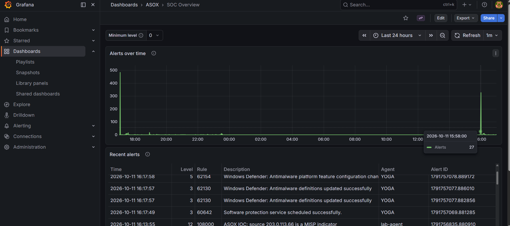
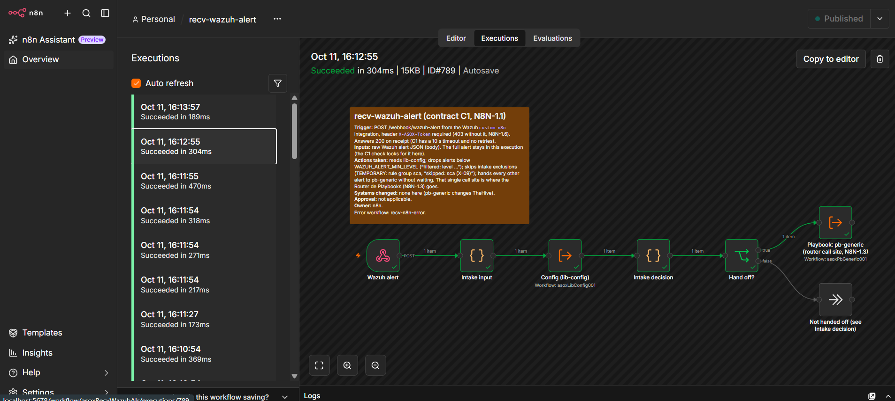
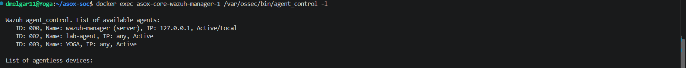

# Wazuh component: delivery evidence

**Component:** Wazuh, "Recolector y Clasificador" (owner Daniel, @dmelgar1110)
**Run on:** 2026-10-10, Daniel's machine (Windows 11 Home, WSL 8 GB, `MEM_PROFILE=low`, `DEPLOY_MODE=single`), branch `wazuh` at the commit that adds this file
**Raw outputs:** [evidence/2026-10-10/](evidence/2026-10-10/)

## Summary

| Check | Result | Output |
|---|---|---|
| Rule tests: every custom rule and decoder, plus the built-ins the scenarios rely on | **55 / 55** | [rule-tests.txt](evidence/2026-10-10/rule-tests.txt) |
| End to end: 11 attack scenarios → rules in the indexer → n8n | **28 / 28**; all 20 alerts at level ≥ 7 reached n8n | [e2e.txt](evidence/2026-10-10/e2e.txt) |
| Contracts C1 (Wazuh → n8n), C2 (n8n → Wazuh API, read-only), C8 (Grafana → indexer) | **all pass** | [contracts-C1-C2-C8.txt](evidence/2026-10-10/contracts-C1-C2-C8.txt) |
| `healthcheck.sh`: core, lab, Suricata | **all pass** | [healthcheck.txt](evidence/2026-10-10/healthcheck.txt) |
| CI checks (`ci-checks.sh all`: compose, shellcheck, XML, JSON, secret scan) | **all pass** | — |
| **Fresh clone** (`git clone` → `topology.env` from the example, `SOC_INSTANCE=fresh`, `low` → `soc.sh init core`), 2026-10-11 | Init green in **11.5 min**, Suricata included. Groups, syslog sources and C14 (off) at start; the lab agent enrolled straight into `linux-servers`. C1/C2/C8 pass, rule tests 55/55, e2e 27/28. The one failure was a race, now fixed: `ssh-success-after-fail` sent its login in the same millisecond as the 8th failure, and the manager's parallel analysis missed 40112. The login now comes 2 s later: 3/3 runs gave 40112. The instance was then reset and deleted | — |
| Agents | manager (000), lab Linux agent (002, `linux-servers`), Daniel's Windows 11 PC (003, `windows-desktops`): all `Active` | — |

To reproduce, with `scripts/soc.sh up core` running:
- `nodes/core/wazuh/tests/run.sh` (about 15 s);
- `nodes/core/wazuh/tests/e2e.sh` (about 6 minutes; wait 5 minutes between runs);
- `scripts/contracts-check.sh --only C1,C2,C8`.

## What the component detects

Full catalog: [README "Detection catalog"](../README.md#detection-catalog-w25). Levels follow [README "Alert levels"](../README.md#alert-levels-w21): level 7 and above goes to n8n, and 12 and above is Critical.

| Source | Detections (level) | Lab scenario |
|---|---|---|
| Linux authentication | SSH brute force 5763 / 5712 (10); login after brute force 40112 (12); **SSH login as root 100200** (10); sudo failures 5404 (10); new user or group 5901 / 5902 (8); **user added to a privileged group 100211 / 100212** (10) | `ssh-bruteforce`, `ssh-success-after-fail`, `root-login`, `sudo-fail`, `new-user` |
| Linux persistence (real-time FIM) | **sudoers 100300, SSH authorized_keys 100301, cron 100302, systemd service 100303** (10) | `persistence` |
| Network IDS (Suricata, ET Open) | **severity 1 / 2 / 3 → 101000 / 101001 / 101002** (12 / 10 / 6); **ET SCAN 101010** (10, T1046) | `ids-test`, `ids-scan` |
| Firewall (OPNsense, syslog) | **port scan 103000** (10, T1046); **web GUI brute force 103011** (10) | `opnsense-scan`, `opnsense-gui-bruteforce` |
| Threat intel (MISP IOCs as CDB lists, C14) | **IOC address 108000 / 108001, IOC in an IDS alert 108010 / 108011, IOC file hash 108020 / 108021** (12) | `ioc-ip` |
| Windows | logon failures 60122 (5), 60204 (10); Windows CIS SCA (5) | `runas` with a wrong password |
| Lab and contracts | test rule 100100 (C1, C8); attack-start marker 100101 (3; MTTD for C11) | every scenario |

Bold rules are ASOX's own (custom IDs 100000–120999); the others are Wazuh built-ins, pinned by `tests/cases/builtin-linux.cases`. Every custom detection carries MITRE ATT&CK in `rule.mitre.id`.

## How it fits the platform

- **C1 Wazuh → n8n:** alerts at level ≥ 7, sent once (integratord is sequential, checked in the 4.14.8 source). The e2e run found every forwarded alert in `recv-wazuh-alert`.
- **Routing:** rule groups are Wazuh's standard names plus `asox` and a source group, agreed with n8n and documented for TheHive's case templates (`docs/request-n8n-rule-groups.md`, `docs/integrator-requests-2026-10-06.md`).
- **Noise:** 21 hours of lab data produced no false positive at level ≥ 7 (W2.4). The known floods are tuned in `rules/1090-tuning.xml`, each with its reason: SCA's first scan, firewall blocks wrongly mapped to brute force, and Suricata engine events.
- **Hardening:** agent enrollment needs a password (D33); syslog only from the manager's own networks plus listed devices (W1.1); no upstream default secrets in `ossec.conf` (W1.2).

## Not covered by this run (and why)

| Item | Status |
|---|---|
| Real OPNsense and Suricata VMs (VirtualBox, another PC) | Needs `DEPLOY_MODE=distributed`, planned for the final integration. Setup steps: README "OPNsense firewall" and [ENROLLMENT.md](../ENROLLMENT.md) "Suricata sensor VM". The scenarios send the same log formats today |
| C14 permanently on | Built and tested with a local MISP event. It needs Diego's Read Only MISP user and Inigo's R-08 variables (`request-cortex-misp-c14-design.md`) |
| End-to-end in `full` mode with TheHive (WD.3) | Integrator, on the 32 GB machine, after the final checkpoint merge |

## Screenshots (2026-10-11, right after `tests/e2e.sh`)

**Grafana, "SOC Overview":** the e2e run's spike. Recent alerts include 108000 (MISP IOC, level 12) from `lab-agent` and the Windows agent YOGA's Defender events.

**n8n, `recv-wazuh-alert` (C1):** the executions of the run, all succeeded in 0.2–0.5 s.

**Agents:** the manager, the lab Linux agent and Daniel's Windows 11 PC (YOGA), all `Active`.

## Burst timing fix (2026-10-11)

A run on 2026-10-11 gave 25/28: 5763, 40112 and 103000 missed. The scenarios wrote their lines in one burst (same millisecond), and the manager's parallel analysis sometimes counted fewer events than the frequency rules need. The scenarios now send lines 0.1 s apart, with a margin over each threshold (10 SSH failures for 8, 12 ports for 10, 7 web GUI failures for 5). Afterwards, `opnsense-scan` plus `ssh-success-after-fail` passed 3 rounds out of 3. Real attacks are never that synchronous, so this only affected the lab's replays.

The next full run gave 27/28, for a good reason. `new-user` ran a few minutes after several `ssh-success-after-fail` runs, so the account creation raised Wazuh's built-in **40501** (level 15, "attacks followed by the addition of a user", 4+ `attacks` alerts within 5 min) in place of 5901 or 5902. That's the platform correlating the attack chain. `e2e.sh` now accepts 40501 for either, and the catalog lists it.
